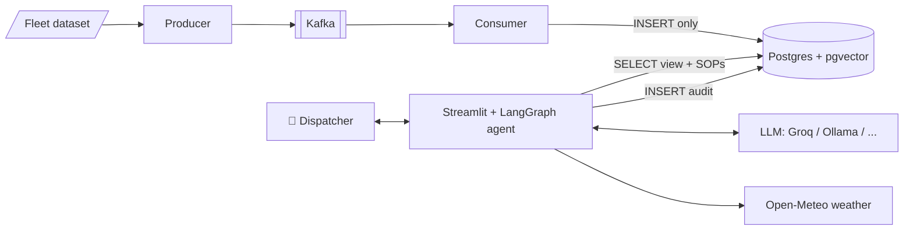

# 🧊 Cold-Chain Logistics FDE Agent

An AI dispatch assistant for refrigerated trucking. A dispatcher asks a question in plain English. The agent queries **live fleet telemetry**, checks **real-time weather** and searches the company's **SOP rulebook**, then answers with a rule-backed action plan. Every step is audited, and the AI only gets read-only access to the data.

> *"Find shipments near Los Angeles, check the weather, and tell me if the cargo temperature violates the SOP for fresh perishables."*
>
> → SQL on the fleet view → weather API → SOP vector search → **Executive summary · data table · action plan with SOP citation**

## Features

- 🤖 **Tool-using agent** (LangGraph) that decides for itself which of three tools it needs: read-only SQL, live weather and SOP search
- 📡 **Live telemetry stream** through Kafka: a simulated IoT gateway sends one reading per second into Postgres
- 📚 **RAG over SOP documents** with pgvector (Markdown, PDF, TXT, CSV and Excel; re-ingests only changed files)
- 🛡️ **Least-privilege security**: a separate DB login per component, the agent sees only a clean view and has read-only sessions, and the audit log is insert-only
- 🖥️ **Streamlit app** with four pages: Dispatch Console, Live Telemetry, Historic Data and Security & Audit Logs
- 🔌 **Pluggable LLM**: Groq (free), Ollama (local), DeepSeek or OpenAI
- 🐳 **One-command local stack** with Docker Compose; no cloud account needed

## Architecture



## Quick start

**Prerequisites:** [Docker Desktop](https://www.docker.com/products/docker-desktop/), Python 3.12, and a free [Groq API key](https://console.groq.com/keys) (or [Ollama](https://ollama.com) installed locally).

```bash
pip install -r requirements.txt
copy .env.example .env
```

In `.env`, set your passwords, then `Agent_llm=GROQ` and `GROQ_API_KEY=...`.

```bash
docker compose up -d db
python scripts/ingest_legacy_data.py
python scripts/ingest_sop_pgvector.py
docker compose up -d --build
```

Open **http://localhost:8501**.

The fleet dataset (from Kaggle, see `data/source/data.txt`) is included in `data/raw/`. Full step-by-step setup, including security checks and test questions, is in [docs/instrutions.md](docs/instrutions.md).

## Documentation

| Document | What's in it |
|---|---|
| [docs/instrutions.md](docs/instrutions.md) | Setup commands, phase by phase |
| [docs/PROJECT_GUIDE.docx](docs/PROJECT_GUIDE.docx) | The complete guide: problem statement, architecture, data flow, Kafka, RAG, agent loop, security model, design decisions, troubleshooting and glossary, with 10 diagrams |

## Tech stack

| Layer | Tools |
|---|---|
| Agent | LangGraph, LangChain, Groq / Ollama / DeepSeek / OpenAI |
| Data | PostgreSQL 16, pgvector, SQLAlchemy |
| Streaming | Apache Kafka 3.9 (KRaft), confluent-kafka |
| Embeddings | BAAI/bge-m3 (local) or OpenAI |
| UI | Streamlit |
| Infra | Docker Compose |

## Project structure

```
db/init/        SQL bootstrap: tables, clean view, least-privilege logins
scripts/        batch ingest, SOP → pgvector, Kafka producer and consumer
src/            agent tools, LangGraph orchestrator, Streamlit UI
data/policy/    SOP documents (the RAG knowledge base)
docs/           setup instructions and the full project guide
```
