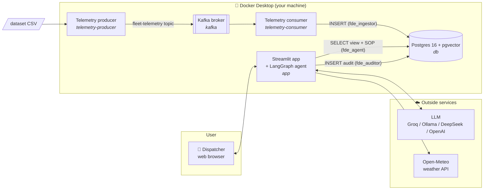
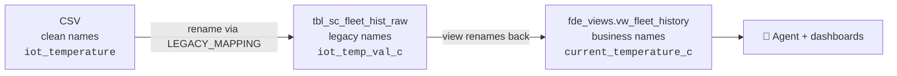
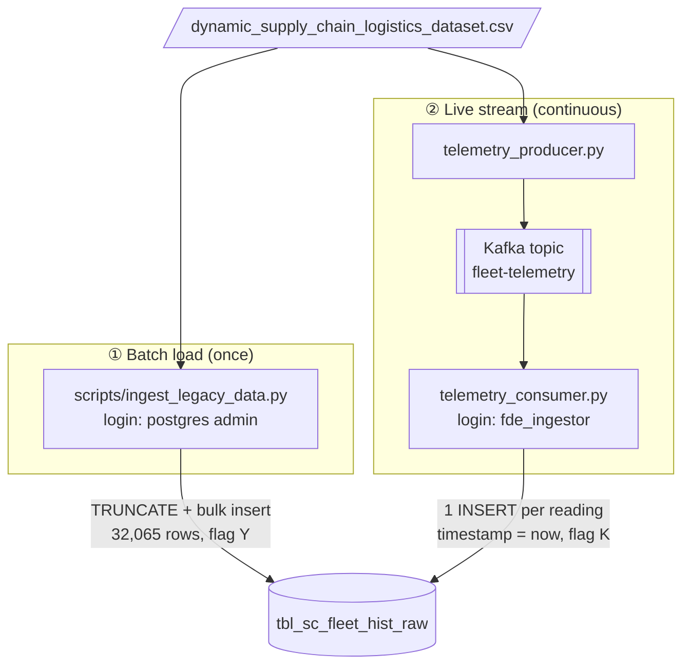
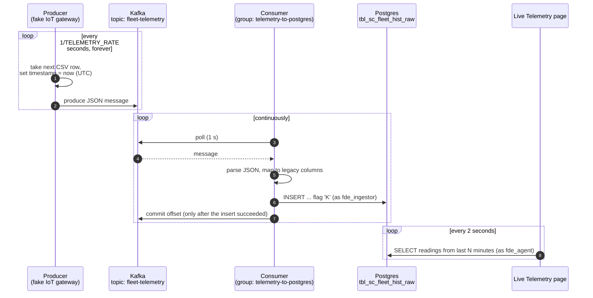
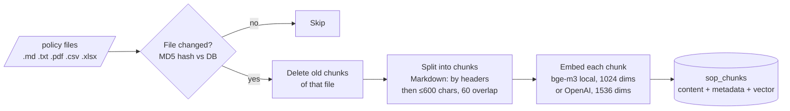
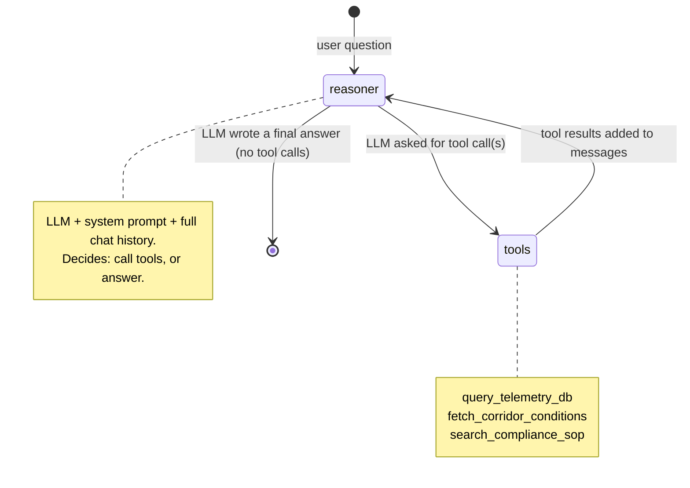
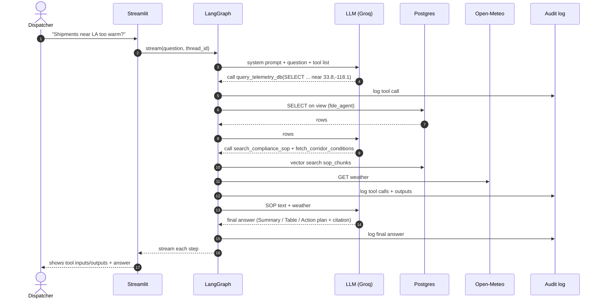
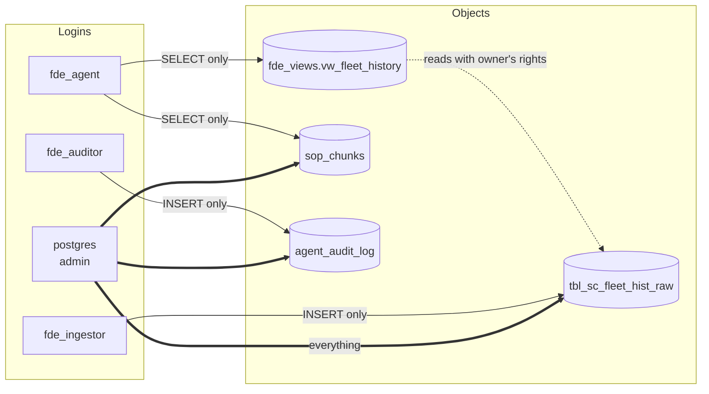
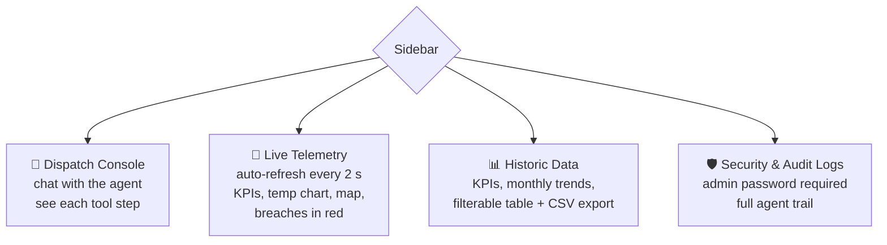
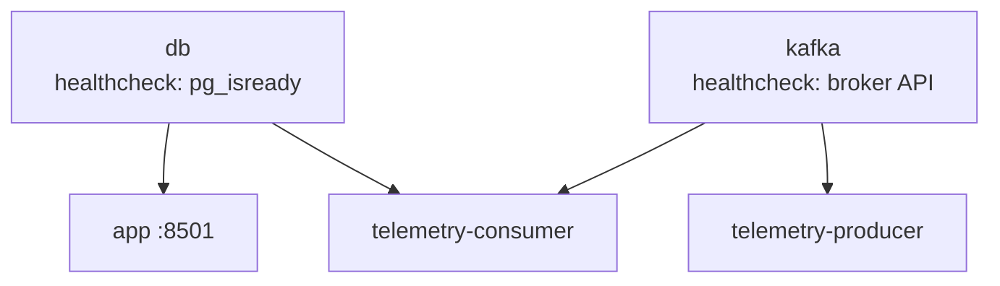

# Cold-Chain Logistics FDE Agent: Complete Project Guide

This guide explains the whole project from start to finish. You don't need any prior context. Read it top to bottom once, and you will know **what** the project does, **why** it exists, **how** every piece works, and **where** to look in the code.

> For the hands-on setup commands, see [instrutions.md](instrutions.md). This guide explains the *thinking*; that file lists the *steps*.

---

## Table of contents

1. [The problem](#1-the-problem)
2. [The solution in one paragraph](#2-the-solution-in-one-paragraph)
3. [Who uses it and what they can ask](#3-who-uses-it-and-what-they-can-ask)
4. [Architecture at a glance](#4-architecture-at-a-glance)
5. [The data: where it comes from and how it moves](#5-the-data-where-it-comes-from-and-how-it-moves)
6. [Live telemetry with Kafka](#6-live-telemetry-with-kafka)
7. [The SOP knowledge base (RAG with pgvector)](#7-the-sop-knowledge-base-rag-with-pgvector)
8. [The AI agent (LangGraph)](#8-the-ai-agent-langgraph)
9. [Security model](#9-security-model)
10. [The web app (Streamlit)](#10-the-web-app-streamlit)
11. [Running everything (Docker)](#11-running-everything-docker)
12. [Configuration reference](#12-configuration-reference)
13. [Repository map](#13-repository-map)
14. [Design decisions and trade-offs](#14-design-decisions-and-trade-offs)
15. [How the project evolved](#15-how-the-project-evolved)
16. [Known limitations](#16-known-limitations)
17. [Ideas for the future](#17-ideas-for-the-future)
18. [Troubleshooting](#18-troubleshooting)
19. [Glossary](#19-glossary)

---

## 1. The problem

A logistics company moves **refrigerated cargo** (fresh food, medicine) in trucks. Every truck has IoT sensors that report GPS position, cargo temperature, risk scores, delay probability and port congestion.

When something goes wrong (a truck's cargo warms up, a port gets congested), a **night-shift dispatcher** has to react fast. Today that means:

| Pain point | Why it hurts |
|---|---|
| **Data is locked in a legacy database** with cryptic column names like `iot_temp_val_c`, `prt_cng_lvl`, `risk_cls_txt` | Dispatchers can't write SQL, and even analysts have to decode the schema first. |
| **Rules live in a separate SOP document** (Standard Operating Procedure) | The dispatcher has to remember or look up thresholds ("fresh perishables must stay 0–4 °C") under time pressure. |
| **External conditions (weather) are in yet another place** | Deciding whether the truck or the environment is the problem means checking a third source. |
| **No audit trail** of what was looked at and why | After an incident, nobody can show how a decision was reached. |
| **Giving an AI database access is dangerous** | A model that writes SQL could, in theory, read sensitive tables or delete data. |

**The core question:** *How can a non-technical person safely "chat with" live fleet data, the company's rules and the outside world, and get a clear, rule-backed action plan in seconds?*

This is a typical **Forward Deployed Engineer (FDE)** problem: take messy enterprise data and systems as they are, and put a safe, useful AI layer on top without rewriting the legacy systems.

---

## 2. The solution in one paragraph

A dispatcher types a question in plain English into a web app. An **AI agent** (an LLM in a LangGraph loop) decides which of three **tools** it needs: (1) run a read-only SQL query on a **clean view** of the fleet database, (2) fetch **live weather** for a GPS location, (3) search the **SOP documents** by meaning (vector search). It combines the results and answers in a fixed business format: summary, data table, and an action plan that cites the SOP rule. Meanwhile **Kafka** streams simulated live sensor readings into the database, so the data keeps changing like a real fleet. Every agent step is written to an **audit log**, and every component uses a **separate database login with the least privileges it needs**.

---

## 3. Who uses it and what they can ask

**Primary user:** a dispatcher or operations manager. They don't need SQL or any technical knowledge.

**Example questions**

| Question | What the agent does |
|---|---|
| "Find active shipments near Los Angeles (~33.8, -118.1). Check the weather and tell me if the cargo temperature violates the SOP for fresh perishables." | Uses **all three tools**: SQL for nearby readings, weather for that point, SOP search for the temperature rule. Then it gives an action plan. |
| "Explain the difference between a Tier 1 and Tier 2 escalation." | Uses **only the SOP search**. No data needed, so it doesn't query telemetry (the "restraint" test). |
| "What are the 5 most recent readings, and are any above 8 °C?" | Uses **SQL** on the live data that Kafka is streaming in. |

**Answer format** (enforced by the system prompt in [src/prompts/system_prompt.txt](../src/prompts/system_prompt.txt)):

1. **Executive Summary**: 1–2 sentences plus the immediate risk
2. **Telemetry & Environment Analysis**: a table with location, temperature, risk and weather
3. **Required Action Plan**: numbered steps taken from the SOP, plus a **citation** of the exact SOP rule

---

## 4. Architecture at a glance



| Component | Technology | Job |
|---|---|---|
| `db` | Postgres 16 with the **pgvector** extension | Stores fleet readings, SOP text and vectors, and the audit log in **one** database |
| `app` | **Streamlit** (UI) + **LangGraph** (agent) | Chat console, live dashboard, historic browser, audit viewer |
| `kafka` | **Apache Kafka 3.9** (KRaft mode, single node) | Message broker for the live sensor stream |
| `telemetry-producer` | Python + `confluent-kafka` | Pretends to be the trucks' IoT gateway: sends one reading per second |
| `telemetry-consumer` | Python + `confluent-kafka` | Reads the stream and writes each reading into Postgres |
| LLM | Groq (free tier, recommended), Ollama (local), DeepSeek or OpenAI | The "brain" that decides which tools to call and writes the answer |
| Weather | Open-Meteo (free, no key) | Live temperature and wind for a GPS point |

---

## 5. The data: where it comes from and how it moves

### 5.1 The dataset

- **Source:** the Kaggle "Logistics and Supply Chain Dataset" (link in [data/source/data.txt](../data/source/data.txt))
- **File:** `data/raw/dynamic_supply_chain_logistics_dataset.csv`
- **Size:** 32,065 hourly readings from **2021-01-01 to 2024-08-29**, with about 26 columns
- **We use 9 columns:** timestamp, GPS latitude/longitude, IoT temperature, cargo condition, risk classification, delay probability, port congestion, route risk

> ⚠️ The dataset is **synthetic**: temperatures range roughly from -10 °C to 40 °C at random, so many readings "breach" the SOP. That is fine for a demo, because it gives the agent plenty of incidents to find.

### 5.2 Simulating a legacy system

Real enterprises have old databases with ugly names. To make the project realistic, the CSV is loaded into a table with **cryptic 2000s-style column names**, and then a **clean view** is put on top. This is the "semantic layer" pattern.



| CSV column | Raw table column (legacy) | View column (what the agent sees) |
|---|---|---|
| `timestamp` | `ts_utc` | `event_time` |
| `vehicle_gps_latitude` | `v_lat` | `latitude` |
| `vehicle_gps_longitude` | `v_lon` | `longitude` |
| `iot_temperature` | `iot_temp_val_c` | `current_temperature_c` |
| `cargo_condition_status` | `cgo_cond_cd` | `cargo_condition_score` |
| `risk_classification` | `risk_cls_txt` | `risk_classification` |
| `delay_probability` | `delay_prob_dec` | `delay_probability` |
| `port_congestion_level` | `prt_cng_lvl` | `port_congestion_level` |
| `route_risk_level` | `rt_rsk_idx` | `route_risk_index` |
| *(added)* | `sys_ingest_flag` | *(hidden)*: `Y` = batch load, `K` = arrived live via Kafka |

The mapping lives in **one place**, `LEGACY_MAPPING` in [src/db.py](../src/db.py), and both the batch loader and the Kafka consumer use it.

**Why a view?** The LLM gets readable column names, so it writes correct SQL more often. The raw table stays hidden, and the view is the *only* fleet object the agent is allowed to read.

### 5.3 Two ways data enters the database



1. **Batch (history):** `ingest_legacy_data.py` empties the raw table and reloads the whole CSV. It uses `TRUNCATE` + append instead of "replace", because "replace" would drop the table and break the view that depends on it.
2. **Stream (live):** described in the next section.

---

## 6. Live telemetry with Kafka

### 6.1 Why Kafka?

Real trucks don't send a CSV once. They send a **continuous stream** of readings. Kafka is the industry-standard way to carry such streams: producers write messages to a **topic**, consumers read them at their own pace, and the broker holds messages in between, so neither side has to wait for the other.

### 6.2 How it works



**Important details**

| Detail | Choice | Why |
|---|---|---|
| Timestamp | Replaced with **current UTC time** | Readings look live, so "latest readings" questions work |
| Rate | `TELEMETRY_RATE` (default 1/second) | About 86,000 rows per day; easy to change |
| Looping | Restarts at row 1 after the last row | The demo never runs out of data |
| Delivery guarantee | **At-least-once**: the offset is committed *after* the DB insert | If the consumer crashes mid-way, the message is re-read, not lost |
| Bad messages | Logged and skipped (offset committed) | One malformed message can't block the whole pipeline |
| DB login | `fde_ingestor`, **INSERT-only on the raw table** | Even a malicious message can't read or delete anything |
| Broker mode | **KRaft** (no ZooKeeper), single node, replication factor 1 | Smallest setup that works on a laptop |
| Listeners | `kafka:9092` inside Docker, `127.0.0.1:29092` from your PC | Containers and host scripts both connect. `127.0.0.1` rather than `localhost`, because Windows may try IPv6 first and fail |

The code is in [scripts/telemetry_producer.py](../scripts/telemetry_producer.py) and [scripts/telemetry_consumer.py](../scripts/telemetry_consumer.py).

**The agent needed no changes for live data.** It reads the same view, which simply keeps growing.

---

## 7. The SOP knowledge base (RAG with pgvector)

### 7.1 The SOP

[data/policy/Cold_Chain_Incident_SOP_v2.md](../data/policy/Cold_Chain_Incident_SOP_v2.md) contains three rule sections:

| Section | Rule | Action |
|---|---|---|
| 1. Temperature | Fresh perishables must stay **0.0–4.0 °C**; above 4.0 °C is a **critical breach** | Contact the driver to restart the cooling unit; if the delay is over 1 h, divert to emergency cold storage |
| 2. Port congestion | Long Beach / LA congestion **> 7.0** suspends standard routing | Divert to the Inland Empire Overflow Depot (San Bernardino) |
| 3. Risk escalation | **High Risk** and delay probability **> 0.65** | Escalate to the Tier 2 Logistics Manager |

### 7.2 What is RAG?

**Retrieval-Augmented Generation:** instead of hoping the LLM "knows" your company rules, you **search your own documents** for the relevant passages and hand them to the LLM along with the question. The search is by **meaning** (vectors), not keywords, so "how cold must lettuce be?" finds the "Fresh Perishables" rule.

### 7.3 Ingestion pipeline



[scripts/ingest_sop_pgvector.py](../scripts/ingest_sop_pgvector.py) handles this:

- **Several formats:** Markdown (split by headers first, so each chunk keeps its section title), plain text, PDF (page by page), and CSV/Excel (one chunk per row)
- **Incremental:** each chunk stores its file's MD5 hash, and unchanged files are skipped. Chunks of deleted files are purged. The database itself is the cache, so no separate cache file can drift out of sync.
- **Same model at query time:** the agent must embed questions with the *same* model used for ingestion, otherwise the vectors aren't comparable

### 7.4 Retrieval at question time

```sql
SELECT source_file, metadata->>'file_format', content
FROM sop_chunks
ORDER BY embedding <=> CAST(:q AS VECTOR)   -- <=> is cosine distance: smaller = more similar
LIMIT 2
```

The two closest chunks go back to the LLM along with their source file name, which is how the answer can **cite** the SOP.

---

## 8. The AI agent (LangGraph)

### 8.1 The loop

The agent is a small **state machine** built with LangGraph ([src/orchestrator.py](../src/orchestrator.py)). It is a "ReAct" style loop: *reason → act (call a tool) → observe → reason again*, until the LLM decides it has enough to answer.



- **State:** a list of messages (user, AI, tool results). `add_messages` appends rather than overwrites.
- **System prompt:** added to *every* LLM call (not stored in the chat history), so it can't be lost or diluted.
- **Memory:** `MemorySaver` keeps each browser session's conversation by `thread_id`, so follow-up questions work. It is in memory only and resets when the app restarts.

### 8.2 The three tools

Defined in [src/agent_tools.py](../src/agent_tools.py). The **docstring of each tool is what the LLM reads** to decide when and how to use it.

| Tool | Input | What it does | Safety |
|---|---|---|---|
| `query_telemetry_db` | SQL string | Runs a query on `fde_views.vw_fleet_history`, returns up to 10 rows | Must start with `SELECT`; runs as read-only `fde_agent`; the DB rejects anything else anyway |
| `fetch_corridor_conditions` | latitude, longitude | Calls Open-Meteo for current temperature and wind; wind > 10 km/h means "High Transit Disruption" | 6 s timeout; errors return as text instead of crashing |
| `search_compliance_sop` | question text | Vector search in `sop_chunks`, top 2 chunks with source | Read-only |

Every tool **returns errors as text** instead of raising them, so the LLM can see what went wrong and try again (for example, fix its SQL).

### 8.3 One question, end to end



The UI shows each step as it happens: which tool was chosen, its input, and its raw output (in expandable boxes). The user can therefore check *why* the agent concluded what it did.

### 8.4 Choosing the LLM

Set `Agent_llm` in `.env`:

| Value | Model | Cost | Notes |
|---|---|---|---|
| `GROQ` | `openai/gpt-oss-120b` (change with `GROQ_MODEL`) | Free tier | Recommended: no install, fast; free keys are rate-limited |
| `OLLAMA` | `qwen2.5:7b` on your PC | Free | The code's fallback default. Needs Ollama installed and the model pulled (~4.7 GB) |
| `DEEPSEEK` | `deepseek-v4-flash` | Paid, cheap | Needs `DEEPSEEK_API_KEY` |
| `OPENAI` | `gpt-4o` | Paid | Needs `OPENAI_API_KEY` |

Groq, DeepSeek and OpenAI all speak the **OpenAI API**, so they share one client class (`ChatOpenAI`) with a different `base_url`. The model **must support tool calling**.

---

## 9. Security model

The guiding principle is **least privilege**: every component gets its own database login that can do *only* its job. The real security boundary is the **database permissions**, not the Python code.



| Login | Used by | Can | Cannot |
|---|---|---|---|
| `postgres` (admin) | Batch ingest scripts, audit-log viewer page | Everything | – (only used by trusted scripts and behind the admin password) |
| `fde_agent` | The AI agent and the dashboards | `SELECT` the view and `sop_chunks` | Read the raw table or the audit log, or write anything. Its sessions are also forced **read-only** (`default_transaction_read_only`) |
| `fde_auditor` | Audit-log writer | `INSERT` into `agent_audit_log` | Read, change or delete audit rows, so the log is tamper-resistant |
| `fde_ingestor` | Kafka consumer | `INSERT` into the raw table | Read, update or delete anything |

**Layers of defense against a misbehaving LLM**

1. The tool rejects queries that don't start with `SELECT` (a first filter only)
2. `fde_agent` has **no write grants** at all
3. The session is **read-only** even if a grant slipped through
4. The agent sees only the **view**, never the raw table
5. The tool returns at most **10 rows**, which limits how much data can leave

**Other measures**

- Passwords come from `.env` (git-ignored); `.env.example` holds only placeholders
- The init scripts are `.sh` (not `.sql`), so passwords are read from the environment instead of being written in the repo
- Docker ports bind to **127.0.0.1 only**, so other machines on your network can't reach the DB, Kafka or the app
- **Audit trail:** every tool call, tool output and final answer is stored with the session ID and a timestamp

You can verify the model yourself (Phase 3 in [instrutions.md](instrutions.md)): as `fde_agent`, selecting from the view works, while selecting from the raw table or deleting anything fails.

---

## 10. The web app (Streamlit)

[src/ui.py](../src/ui.py), at http://localhost:8501. The sidebar switches between four pages:



| Page | Data source & login | Highlights |
|---|---|---|
| **Dispatch Console** | Agent (`fde_agent`), writes audit (`fde_auditor`) | Streams each graph step: "Intent Recognized", tool input JSON, raw tool output, final answer |
| **Live Telemetry** | View, last 5/15/30/60 min (`fde_agent`) | `st.fragment(run_every="2s")` re-runs only this panel; adjustable alert temperature; "last reading N s ago" shows the stream is alive |
| **Historic Data** | View (`fde_agent`) | Aggregations run in Postgres (only a few rows reach the app) and are cached for 60 s; browser filters by date, risk class and row cap |
| **Security & Audit Logs** | `agent_audit_log` (admin) | Asks for the Postgres admin user and password from `.env` |

The **Purge** button in the sidebar starts a new session (new `thread_id`), so the agent forgets the conversation.

---

## 11. Running everything (Docker)



`docker compose up -d --build` starts all five containers in the right order: each waits for the **healthchecks** of the services it depends on.

**First-time order of operations** (details in [instrutions.md](instrutions.md)):

1. `copy .env.example .env` and set passwords and the LLM key
2. `docker compose up -d db`. On the very first start, `db/init/01_init.sh` and `02_ingestor.sh` create tables, the view and the logins
3. `python scripts\ingest_legacy_data.py` loads history
4. `python scripts\ingest_sop_pgvector.py` loads SOP vectors (downloads bge-m3, about 2 GB, once)
5. `docker compose up -d --build` starts the app and the Kafka stream
6. Open http://localhost:8501

**Volumes** (data that survives restarts): `pg_data` (the database) and `hf_cache` (the downloaded embedding model). `docker compose down -v` deletes them and starts from zero.

---

## 12. Configuration reference

All settings live in `.env` (template: [.env.example](../.env.example)).

| Variable | Default | Meaning |
|---|---|---|
| `POSTGRES_USER` / `POSTGRES_PASSWORD` / `POSTGRES_DB` | `postgres` / – / `fde` | Admin login and database name |
| `PG_HOST` / `PG_PORT` | `127.0.0.1` / `5432` | Where host scripts find Postgres (Docker services override these) |
| `AGENT_DB_PASSWORD` | – | Password for `fde_agent` |
| `AUDIT_DB_PASSWORD` | – | Password for `fde_auditor` |
| `INGEST_DB_PASSWORD` | – | Password for `fde_ingestor` |
| `Agent_llm` | `OLLAMA` | `GROQ`, `OLLAMA`, `DEEPSEEK` or `OPENAI` |
| `GROQ_API_KEY` / `GROQ_MODEL` | – / `openai/gpt-oss-120b` | Groq credentials and model |
| `DEEPSEEK_API_KEY`, `OPENAI_API_KEY` | – | Other LLM keys |
| `Embeddings_model` | `LOCAL` | `LOCAL` (bge-m3) or `OPENAI`. Must match what the SOPs were ingested with |
| `Local_Embedding_Model` | `BAAI/bge-m3` | Hugging Face model name |
| `KAFKA_BOOTSTRAP` | `127.0.0.1:29092` | Kafka address for host scripts (containers use `kafka:9092`) |
| `TELEMETRY_RATE` | `1` | Readings per second from the producer |

---

## 13. Repository map

```
cold-chain-logistics-FDE-Project/
├── data/
│   ├── raw/dynamic_supply_chain_logistics_dataset.csv   # the fleet dataset
│   ├── policy/Cold_Chain_Incident_SOP_v2.md             # the rules (RAG source)
│   └── source/data.txt                                  # where the dataset came from
├── db/init/
│   ├── 01_init.sh        # tables, view, sop_chunks, audit log, agent + auditor logins
│   └── 02_ingestor.sh    # insert-only login for the Kafka consumer
├── scripts/
│   ├── ingest_legacy_data.py     # batch: CSV -> legacy raw table
│   ├── ingest_sop_pgvector.py    # SOP files -> chunks -> embeddings -> sop_chunks
│   ├── telemetry_producer.py     # CSV -> Kafka (fake live IoT)
│   └── telemetry_consumer.py     # Kafka -> raw table
├── src/
│   ├── db.py              # one helper to connect + LEGACY_MAPPING
│   ├── agent_tools.py     # the three tools + embeddings setup
│   ├── orchestrator.py    # LLM choice + LangGraph loop (+ terminal chat)
│   ├── prompts/system_prompt.txt   # agent behaviour and answer format
│   └── ui.py              # Streamlit app (4 pages)
├── docs/
│   ├── instrutions.md     # step-by-step setup commands
│   └── PROJECT_GUIDE.md   # this file
├── Dockerfile             # app image (CPU-only torch to keep it smaller)
├── docker-compose.yml     # db, app, kafka, producer, consumer
├── requirements.txt       # pinned Python packages
├── .env.example           # config template (copy to .env)
└── .gitattributes         # keeps *.sh files LF so they run in Linux containers
```

---

## 14. Design decisions and trade-offs

| Decision | Alternatives considered | Why this one |
|---|---|---|
| **Postgres + pgvector** for both data and vectors | MSSQL + Pinecone (the original design) | One database, one backup, one permission system; runs locally for free; SQL joins are possible between data and SOPs |
| **Clean view over a legacy table** | Rename the table, or let the LLM read raw columns | Mirrors real enterprises (you can't rename legacy systems); readable names make the LLM's SQL more reliable; the view doubles as the security boundary |
| **Agent loop with tools** (LangGraph) | One big prompt with all the data, or a fixed pipeline | The LLM fetches only what it needs and can skip tools (the "restraint" test); every step is visible and auditable |
| **Separate login per component** | One shared app login | A bug or a prompt injection in one part can't affect the others |
| **Kafka** for live data | Polling the CSV, or direct inserts on a timer | Matches how real IoT streams work; decouples producer and consumer; shows a real streaming pattern |
| **At-least-once delivery** | Exactly-once (transactions) | Much simpler; a rare duplicate reading is harmless for monitoring |
| **KRaft single-node Kafka** | ZooKeeper cluster, Redpanda | Fewest containers and settings; the official Apache image |
| **Groq as the recommended free LLM** | Ollama (local), paid APIs | No install or GPU needed, free, fast; easy to switch with one setting |
| **Local bge-m3 embeddings** | OpenAI embeddings | Free and private; good multilingual quality |
| **Streamlit** | React + an API server | One Python file for the whole UI; fast to build and change |
| **Docker Compose on localhost** | EC2 / cloud deploy (the original design) | Zero cloud cost; anyone can run it with one command |

---

## 15. How the project evolved

| Stage | What existed |
|---|---|
| Phase 0 | MSSQL "legacy" database in Docker on an **AWS EC2** instance; CSV ingestion |
| Phase 1 | SOP ingestion into **Pinecone** (cloud vector DB) |
| Phase 2 | Data security: SQL view plus a read-only login (`USR_FDE_RO`) |
| Phase 3–4 | LangGraph agent with three tools; audit log; Streamlit UI; GitHub Actions deploy to EC2 |
| **Current** | Everything moved to **local Docker**: Postgres + pgvector replaces MSSQL + Pinecone; init scripts create the security model automatically; **Kafka live stream** added; **Groq** added as a free LLM; Live and Historic pages added; the EC2 CI/CD workflow was removed |

---

## 16. Known limitations

- **Synthetic data:** temperatures jump randomly, so most "breaches" are noise, not real equipment trends. There are also no truck or shipment IDs, so the agent identifies trucks by location.
- **No vehicle ID:** you can't follow one specific truck over time.
- **SOP coverage:** the SOP defines only Tier 2 escalation. If you ask about Tier 1, the agent may search repeatedly and then guess. Add the missing rules to the SOP (or tell the prompt to say "not covered") to fix this.
- **Chat memory is in RAM:** conversations are lost when the app restarts.
- **Free LLM limits:** Groq rate-limits free keys, and models get retired (that's why the model is configurable).
- **Live alert default:** the Live page's alert defaults to 8 °C, while the SOP limit for fresh perishables is 4 °C. Adjust it on the page.
- **Mixed charts:** the historic monthly charts include live rows, so the current month appears after 2024.
- **Single-node Kafka:** fine for a demo, with no fault tolerance.
- **No user login on the app:** anyone who can reach `localhost:8501` can use the console. The audit page is protected by the DB admin password.

---

## 17. Ideas for the future

- **Proactive alerts:** a second consumer on the Kafka topic that checks each reading against the SOP and pushes alerts (Slack or email) without anyone asking
- **Vehicle IDs:** add a `vehicle_id` to the producer so trucks can be tracked over time
- **Persistent chat memory:** use LangGraph's Postgres checkpointer instead of `MemorySaver`
- **Evaluation set:** a list of questions with expected tools and answers, run automatically after every change
- **App login:** Streamlit authentication or a reverse proxy with SSO
- **CI:** a GitHub Actions job that builds the image and runs the tool tests
- **Separate live and historic data** in the dashboards using `sys_ingest_flag`

---

## 18. Troubleshooting

| Symptom | Cause | Fix |
|---|---|---|
| `failed to connect to the docker API ... dockerDesktopLinuxEngine` | Docker Desktop isn't running (or is still starting) | Start Docker Desktop, wait until it says "running", retry |
| Chat shows `model_not_found` (404) | The LLM provider retired the model | Set a current model, e.g. `GROQ_MODEL=...`, then `docker compose up -d app` |
| Chat shows `Invalid API Key` (401) | Key missing or wrong in `.env` | Fix `GROQ_API_KEY=` (no `#`, quotes or spaces), restart the app |
| Chat shows connection refused to `11434` | `Agent_llm=OLLAMA` but Ollama isn't installed or running | Install Ollama and `ollama pull qwen2.5:7b`, or switch to `GROQ` |
| Live page: "No live readings in this window" | Producer or consumer not running | `docker compose up -d telemetry-producer telemetry-consumer` |
| Consumer log: `password authentication failed for user "fde_ingestor"` | DB volume was created before `02_ingestor.sh` existed | `docker compose exec db bash /docker-entrypoint-initdb.d/02_ingestor.sh` |
| Host script hangs connecting to Postgres or Kafka | `localhost` resolved to IPv6 on Windows | Use `127.0.0.1` in `.env` |
| Code change doesn't show up in the app | The app runs from the built image | `docker compose up -d --build app` |
| Init scripts fail with `\r: command not found` | `.sh` files got Windows line endings | `.gitattributes` forces LF; re-checkout the files |
| `UnicodeEncodeError` when piping script output on Windows | Emoji in prints with a non-UTF-8 console | `set PYTHONIOENCODING=utf-8` |

---

## 19. Glossary

| Term | Meaning |
|---|---|
| **FDE** | Forward Deployed Engineer: an engineer who builds solutions directly on a customer's real systems and data |
| **Cold chain** | A temperature-controlled supply chain (refrigerated transport and storage) |
| **SOP** | Standard Operating Procedure: the company's written rules for handling situations |
| **IoT telemetry** | Sensor readings sent automatically by devices (here: trucks) |
| **LLM** | Large Language Model, e.g. GPT, Llama, Qwen |
| **Agent** | An LLM that can decide to call tools (functions) and use their results |
| **Tool calling** | The LLM's ability to output a structured request like `query_telemetry_db(sql=...)` instead of plain text |
| **LangGraph** | A library for building agents as graphs of steps (nodes) and transitions (edges) |
| **RAG** | Retrieval-Augmented Generation: search your documents, then give the matches to the LLM |
| **Embedding / vector** | A list of numbers that represents the *meaning* of a text; similar meanings give nearby vectors |
| **pgvector** | A Postgres extension that stores vectors and finds the nearest ones |
| **Cosine distance (`<=>`)** | How different two vectors' directions are; 0 = same meaning |
| **Chunk** | A small piece of a document (here ≤600 characters) that is embedded and searched separately |
| **View** | A saved SQL query that looks like a table; here it renames and hides the raw table |
| **Least privilege** | Give each component only the permissions it strictly needs |
| **Kafka topic** | A named stream of messages (here `fleet-telemetry`) |
| **Producer / consumer** | A program that writes to / reads from a Kafka topic |
| **Consumer group / offset** | Kafka tracks, per group, how far it has read (the offset), so it can resume after a restart |
| **KRaft** | Kafka's built-in coordination mode, which no longer needs ZooKeeper |
| **At-least-once** | Every message is processed at least once; duplicates are possible, losses are not |
| **Streamlit fragment** | A part of a Streamlit page that re-runs on its own (here every 2 s) |
| **Docker Compose** | A tool that starts several containers together from one YAML file |
